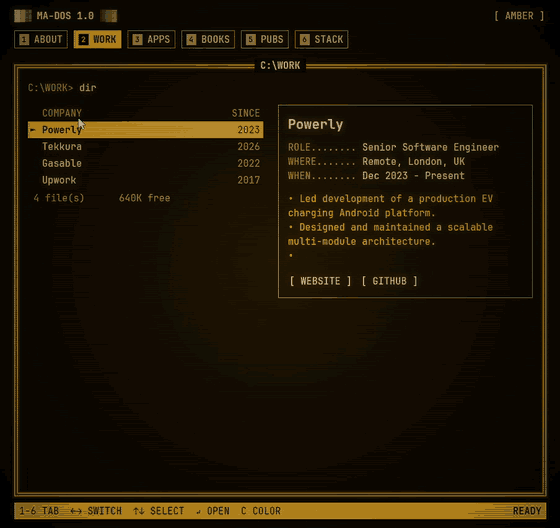

# compose-dos-portfolio

An old-school DOS-style portfolio, built with Kotlin and Compose Multiplatform.

**[ma7moud3ly.github.io](https://ma7moud3ly.github.io)**


## Features

- The CRT switching on with static noise, then five tabs: About, Stack, Apps, Books and Pubs
- Amber and green screens, with scanlines and a phosphor glow
- Keyboard control: `1`-`5` open a tab, `←` `→` switch tabs, `↑` `↓` pick an item,
  `Enter` opens its link, `C` switches the color
- Works on wide screens and phones
- Runs in the browser (Kotlin/Wasm) and as a desktop app

## Make it yours

1. Clone the repository

   ```bash
   git clone https://github.com/Ma7moud3ly/compose-dos-portfolio.git
   ```

2. Put your content in
   [`PortfolioData.kt`](composeApp/src/commonMain/kotlin/ma7moud3ly/github/io/data/PortfolioData.kt):
   profile, skills, apps, books and publications.
3. Add any letter of your name that is missing from `Glyphs` in
   [`BlockTitle.kt`](composeApp/src/commonMain/kotlin/ma7moud3ly/github/io/ui/components/BlockTitle.kt).
   Each letter is five rows of `█`.
4. Set the page title, description and structured data in
   [`index.html`](composeApp/src/wasmJsMain/resources/index.html), and replace the
   `google-site-verification` tag with your own from Google Search Console, or remove it.
5. Optionally, change the screen colors in
   [`Phosphor.kt`](composeApp/src/commonMain/kotlin/ma7moud3ly/github/io/ui/theme/Phosphor.kt).

## Run

```bash
# web, development server
./gradlew :composeApp:wasmJsBrowserDevelopmentRun

# desktop window with hot reload
./gradlew :composeApp:hotRunJvm
```

The `android` target renders the `@Preview` composables in Android Studio.

## Publish

```bash
./gradlew :composeApp:wasmJsBrowserDistribution
```

Copy the contents of `composeApp/build/dist/wasmJs/productionExecutable/` to the
root of your `<username>.github.io` repository, or to any static host.

## License

[MIT](LICENSE). The bundled JetBrains Mono font is under the
[SIL Open Font License](licenses/JetBrainsMono-OFL.txt).
